<p align="center">
  
</p>

<h1 align="center">Wren</h1>

<p align="center"><b>A writing app that feels like ink on good paper.</b></p>

<p align="center">
  Native macOS app · SwiftUI + TextKit · macOS 26 · App Sandbox · Plain Markdown files you own
</p>

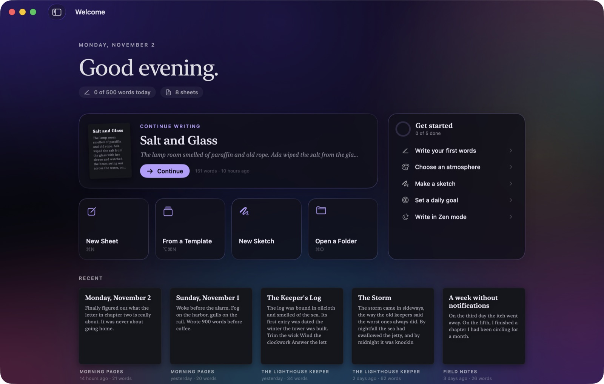

> Screenshots use sample writing in a separate demo copy of the app, not a real library.

---

## Why

Most writing apps look the same: a white rectangle, a sidebar and a toolbar full of buttons. They are fine for
taking notes, and joyless for writing a book.

Wren treats writing as a craft. Light moves softly behind frosted glass and then settles while you type, so nothing
pulls at your eye mid-sentence. Fresh words appear as wet ink and dry as you go. Each launch opens with a brushed
ensō and a seal stamp, then a welcome page that brings you back to where you left off.

Wren is also simple underneath. Every sheet is a **plain `.md` file** in a folder you can open in any other app.
There's no database, no account and no subscription, and if you stop using Wren your writing stays exactly where it
was.

## How it works

1. **Open Wren.** The welcome page shows today's words, the sheet you were writing, and your recent pages as a small
   paper gallery. Press ↩ to continue.
2. **Write.** Press ⌘N for a new sheet; its first line becomes its title. Format with the bar at the top, by
   selecting text, or by typing `/` on an empty line. You never have to learn Markdown.
3. **Organize.** Sheets live in folders. Make a folder a **project** (book, blog or journal) and Wren numbers
   chapters, tracks a word goal and knows what "new" means there.
4. **Ship it.** Preview in a blog style, export to HTML, PDF, Word, EPUB or a ready-to-upload blog folder, or publish
   straight to Ghost, WordPress, Micro.blog, DEV or Hashnode.

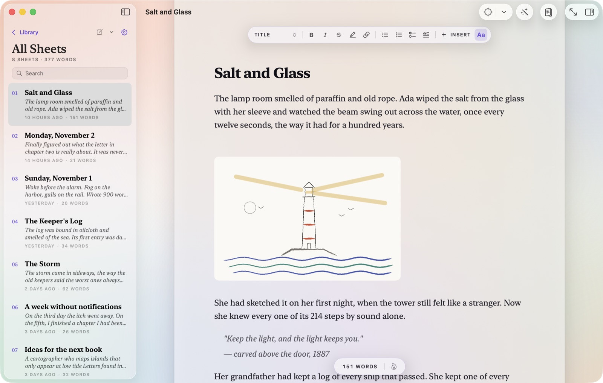

## Atmospheres

Ten themes, each with its own paper, ink and light. **Aurora** and **Dawn** are living light behind frosted glass,
and the light rests (desaturates and dims) while you type. Others drift quietly: stars, ink-wash mountains,
falling code.

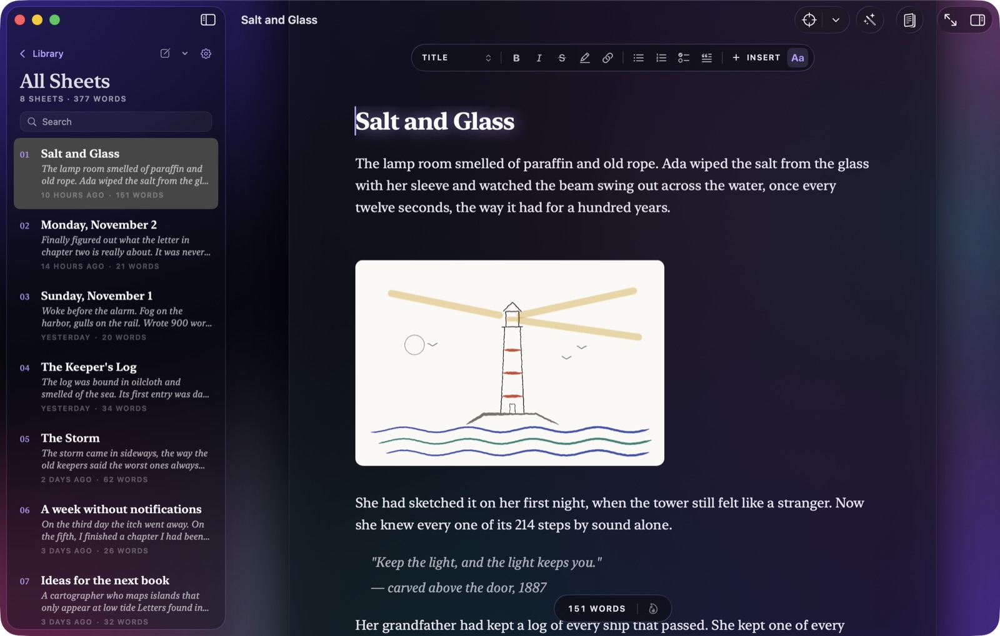

| | |
|---|---|
| 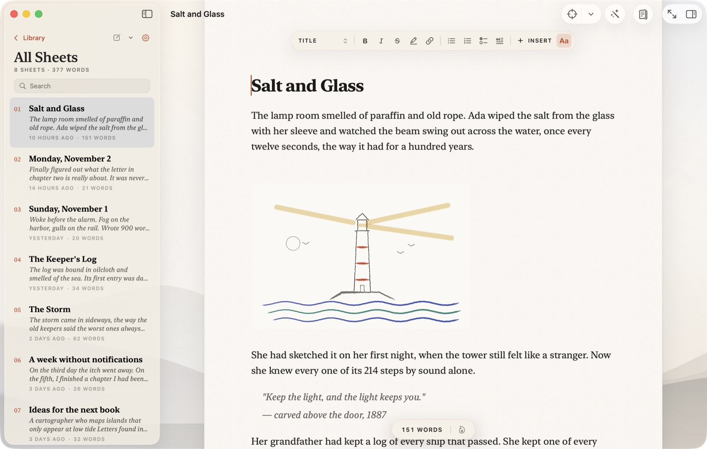 | 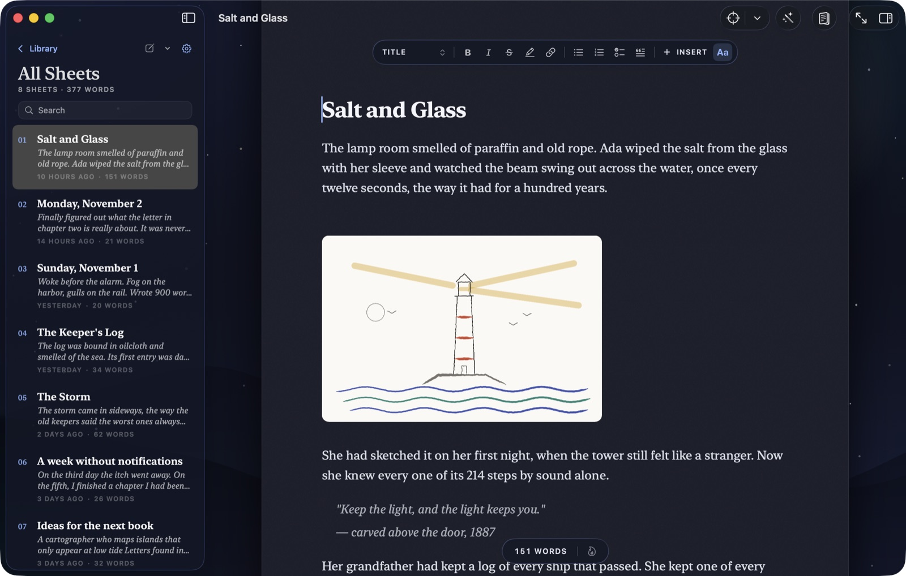 |
| **Ink Wash**: rice paper and distant mountains. | **Starlight**: deep navy under a quiet sky. |
| 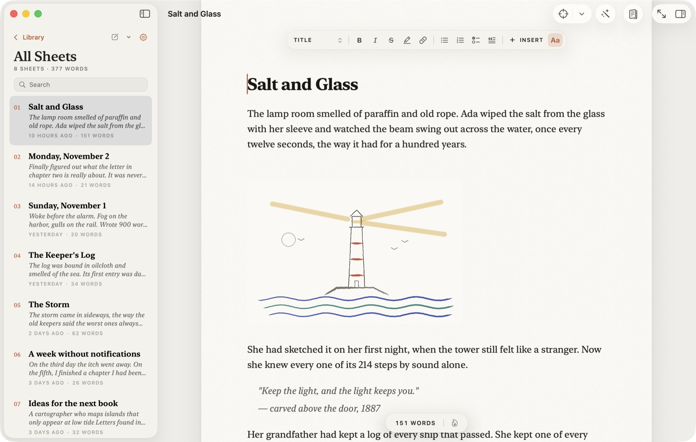 | 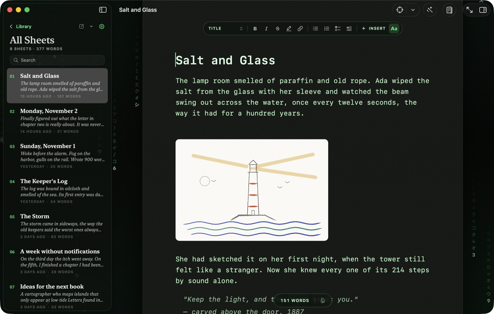 |
| **Paper**: warm off-white, soft ink. | **Terminal**: phosphor green on black. |

Also: Sepia, White, Graphite and Black. Change it in Settings (⌘,), from the gear in the sidebar, or from
**Write › Theme**.

## A tour

### Sketches that stay sketches
Draw right in a sheet with pen, brush, marker and eraser, using pressure from a tablet or (later) Apple Pencil.
Double-click a sketch to keep editing it. Each drawing is saved as a normal **PNG**, so it works in every export,
blog and Markdown app, plus a small `.wrendrawing` file next to it that holds the editable strokes. The engine is
shared code with no AppKit or UIKit dependency, ready for an iPad companion. Drawings have three layers, **Colors**,
**Pencils** and **Inks**: rough it out in pencil, ink over it, and the pencils never show up in the picture.

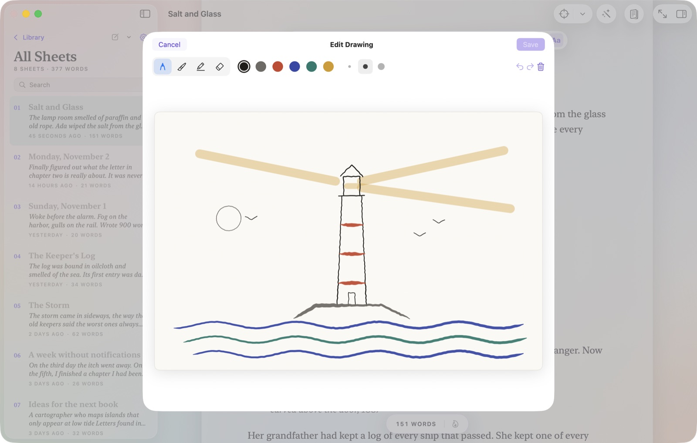

### Resizable media
Drag the corner of any image, sketch or video to resize it. Sizes snap to 5% and are stored in the Markdown itself
(``, the same convention Obsidian uses), so they carry into HTML, PDF and Word.

### Lay out in Magpie
**File › Lay Out in Magpie…** hands the sheet to [Magpie](https://github.com/mrdrms/magpie), which turns it into
magazine pages. The pages stay linked to the sheet: keep writing here and they update in Magpie.

### Preview and publish
A live side-by-side or full preview in five blog styles (Classic, Modern, Editorial, Mono, Terminal), on a desktop
or phone frame. Before anything leaves your Mac, a **secret scanner** warns about API keys, tokens and internal IPs.

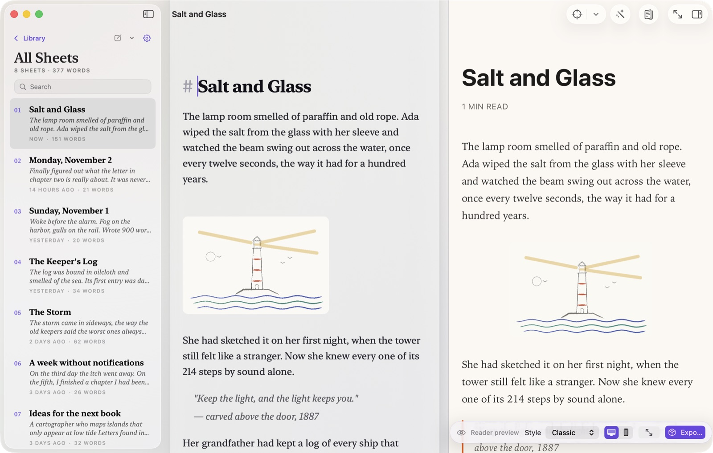

### Everything one keystroke away
The command palette (⌘K) searches sheets and every command, showing each shortcut.

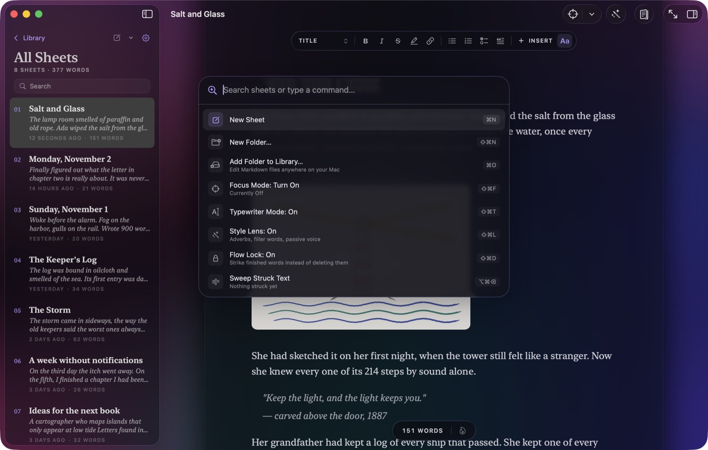

### Write better, without nagging
**Style Lens** (⇧⌘L) marks adverbs, filler, passive voice and echoes (here, "light… light" and "tower… tower") the way
a good editor would. The **Rhythm** gutter shows sentence length at a glance, and **Read Aloud** lets you hear your
draft.

| | |
|---|---|
| 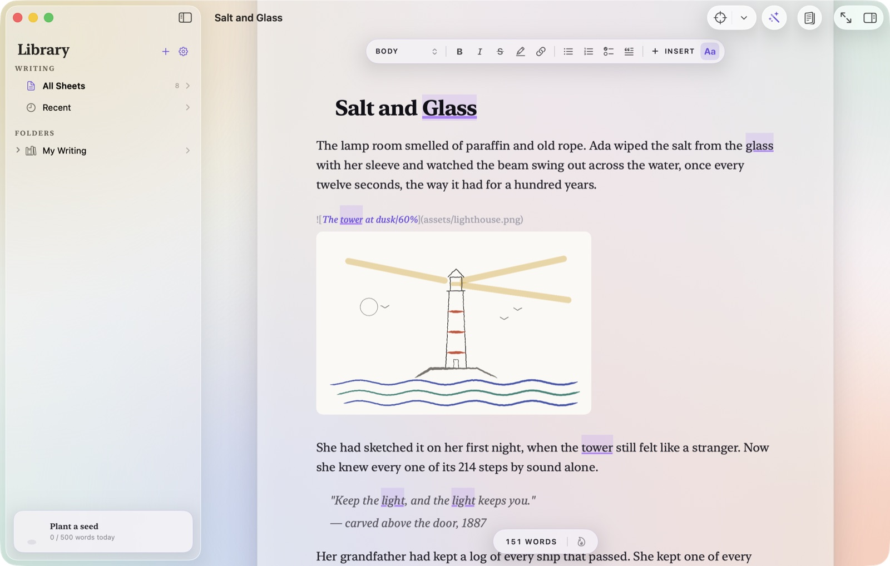 | 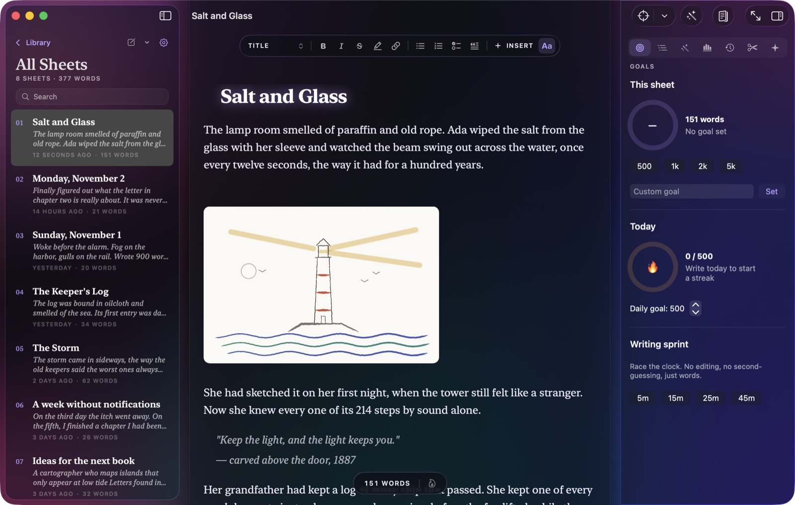 |
| Style Lens on a chapter. | The inspector: goals, outline, style, stats, history, cuts and AI. |

### Focus tools

| | |
|---|---|
| **Zen mode** (⇧⌘↩) | Just you and the page, full screen. |
| **Focus** (⇧⌘F) and **Typewriter** (⇧⌘T) | Dim everything but the sentence or paragraph, and keep your line centered. |
| **Flow Lock** (⇧⌘D) | Finished words get struck through instead of deleted, so you keep moving. **Sweep** (⌥⌘⌫) clears them later. Stored as standard CriticMarkup. |
| **Sprints and Pomodoro** | Race the clock, with optional break screens. |
| **Daily goal, streaks and a Writing Garden** | A plant grows for every day you write. **Writing Journey** (⇧⌘J) shows a heatmap of your year. |

### Never lose a word
Autosave on every pause, **snapshots** (⇧⌘S) before big rewrites, a **Time Machine** that replays every edit, and a
**Cutting Room Floor** that keeps passages you deleted, just in case.

### Books, blogs and journals
- **Books**: numbered chapters (move them up or down and Wren renumbers the files), a word goal, a storyboard of scene cards, footnotes, and
  compile to Word, PDF, EPUB, HTML or one Markdown file with trim size and margins.
- **Blogs**: post details (front matter), an assets folder per post, and one-click publishing.
- **Journals**: "Today's Entry" in one keystroke.
- **14 sheet templates**, from Blog Post and Newsletter to Short Story, Character Profile and Query Letter.

### Optional AI editor
Off by default. Use **Apple Intelligence** on Macs that have it (free, no key, and nothing leaves your Mac), bring
your own key for Anthropic (Claude), OpenAI or Google Gemini, or run fully local with Ollama. Apple's on-device model
is small: it's best for line edits and title ideas, and whole-book reads and image alt text need one of the others.
It does line edits (as margin notes you accept or ignore), critique, continuity checks across a book, synopses and
title ideas. **It never writes for you,** and each request is shown to you before it is sent.

### Open with Wren
Any `.md` file in Finder can be opened with Wren (right-click › Open With). Single files open alongside your library
without being moved.

## Where your writing lives

| | |
|---|---|
| **New sheets** | `~/Library/Containers/com.emredurmus.writer/Data/Documents/Wren Library/`, shown as *My Writing* in the sidebar. **Show in Finder** on any sheet takes you there. |
| **Your own folders** | **Open a Folder** (⌘O) adds any folder on your Mac. Wren edits the `.md` files in place and shows only Markdown sheets and their media. |
| **Single files** | Files opened from Finder stay where they are. Wren can't move, rename or trash them, only edit them. |
| **Images and sketches** | Copied into an `assets/` folder next to the sheet, so a post and its pictures travel together. |
| **Projects** | A small `.wren-project.json` in the folder (kind, goal, author, book layout). Delete it and the folder becomes an ordinary folder again. |

## Safety and privacy

- **Sandboxed.** Wren only sees its own library and the folders and files you choose. Access is kept with
  security-scoped bookmarks.
- **No account, no analytics.** The network is used only for features you turn on: publishing, the AI editor and
  YouTube embeds.
- **Keys stay in the Keychain,** never in preferences or files.
- **Careful with what it opens.** Links that could run code (`file:`, `javascript:`, app schemes) are refused in the
  editor and made inert in exports. Drawing files from shared folders are size-checked and validated before loading.
- **Careful with what it sends.** The secret scanner runs before every export and publish. Blogs that don't
  understand width hints get clean Markdown.
- **Trash, never delete.** Removing a sheet moves it to the macOS Trash.

## Build and run

Requirements: **Xcode 26.3** (macOS 26 SDK) on macOS 26.

```sh
git clone https://github.com/mrdrms/wren.git
cd wren
open writer.xcodeproj
```

Press ⌘R to run the `writer` scheme and ⌘U to run the tests (about 100 unit tests plus UI tests). From the command
line:

```sh
xcodebuild -project writer.xcodeproj -scheme writer build
xcodebuild -project writer.xcodeproj -scheme writer test -only-testing:writerTests
```

If you have more than one Xcode installed, point the command line at 26.3 first, for example
`export DEVELOPER_DIR=/Applications/Xcode-26.3.app/Contents/Developer`. Older Xcode versions can't build the project.

**Signing:** select the **writer** project, then for each target (writer, writerTests, writerUITests) open
**Signing & Capabilities**, choose your **Team**, and change the **Bundle Identifier** if needed (currently
`com.emredurmus.writer`). A new bundle ID starts with a fresh sandbox and an empty library, which is a handy way to
try things without touching your real writing.

**Checking the shared drawing code builds for iOS:**

```sh
xcrun --sdk iphoneos swiftc -typecheck -target arm64-apple-ios26.0 \
  -default-isolation MainActor writer/Shared/Drawing/*.swift
```

## Project layout

```
writer/
  writerApp.swift         App, menus and shortcuts, Open With (app delegate)
  ContentView.swift       Window: sidebar, editor, inspector, welcome page, sheets
  Model/                  Everything that isn't a view
    AppModel.swift          The app's state: open sheet, saving, drawings, commands
    Library.swift           Folders, sheets, projects, opened files, bookmarks
    Preferences.swift       Settings, stored in UserDefaults
    Theme.swift             Themes and their atmospheres
    Images.swift            Media in Markdown: assets folder, width hints
    Exporter.swift          HTML, PDF, Word, blog folder, rich copy
    EPUB.swift, BookLayout.swift   Book compile
    Publishing.swift        Ghost, WordPress, Micro.blog, DEV, Hashnode
    SecretScanner.swift     Finds keys and tokens before anything leaves
    Safety.swift            What Wren will open, follow or send
    AI.swift                Optional AI editor (requests shown before sending)
    TextAnalysis.swift      Style Lens and Rhythm
    Drafting.swift          Flow Lock (CriticMarkup strikes)
    History.swift, Snapshots.swift   Time Machine and snapshots
    Templates.swift         Sheet and project templates
  Editor/                 The text engine (TextKit 1)
    WrenTextView.swift      NSTextView subclass: inline media, resize grips, wet ink
    MarkdownEditor.swift    SwiftUI bridge, live formatting
    MarkdownHighlighter.swift   Typography and Markdown styling
  Views/                  SwiftUI screens (Welcome, Navigator, Editor, Inspector, Preview, Settings…)
    AtmosphereView.swift    The animated light and scenes behind the page
    Ritual.swift            The opening ensō and seal
  Shared/Drawing/         Drawing engine shared with a future iPad/iPhone app (no AppKit/UIKit)
    InkModel.swift          Strokes, tools, colors, file format and validation
    InkRenderer.swift       Smoothing, brush taper, PNG output
    InkEditor.swift         Tools, undo/redo, eraser
    InkCanvas.swift         Mac and iOS canvases (tablet pressure, Apple Pencil)
    DrawingStudio.swift     The drawing screen
writerTests/              Unit tests (Markdown, export, publishing, books, drawings, safety)
writerUITests/            UI tests
writer-Info.plist         Document types for Open With
docs/                     README images
```

## Notes for contributors

- **The file is the truth.** Anything Wren adds must survive a round trip through a plain text editor and other
  Markdown apps. Prefer existing conventions (CriticMarkup, Obsidian-style widths, front matter) over new syntax.
- **Calm by default.** New UI should be quiet while someone is writing: no badges, no motion near the text, and
  tooltips on every icon.
- **Main actor by default.** The project uses `SWIFT_DEFAULT_ACTOR_ISOLATION = MainActor`. Mark pure value types
  `nonisolated`, as `Shared/Drawing` does.
- **Keep `Shared/` portable.** No AppKit or UIKit outside `#if os(...)` blocks. Run the iOS type-check above before
  pushing changes there.
- **Treat files from disk as untrusted.** Sheets and drawings can come from shared folders, so validate sizes and
  values the way `DrawingFiles.validated` does.
- New files in `writer/` are picked up automatically (synchronized folder groups); there's no need to edit the
  project file.
